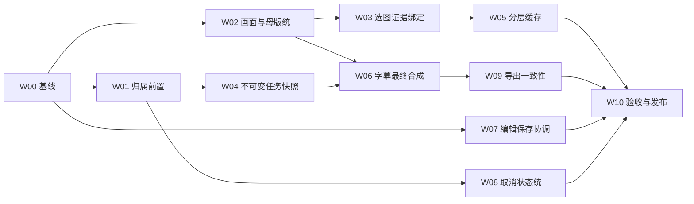

# 第二次迭代落地实施计划

日期：2026-11-16  
状态：2026-11-16 已按 W00–W10 落地，结果见[落地结果](D:/02_Competation/01_AIC/YiYanStudio-V3-完整源码/一言片场-V3/docs/第二次迭代-落地结果-2026-11-16.md)。  
依据：[本轮审计复核报告](D:/02_Competation/01_AIC/YiYanStudio-V3-完整源码/一言片场-V3/docs/第二次迭代-审计复核报告-2026-11-16.md)。

## 1. 本轮目标与范围

第二轮交付目标：**同一项目的编辑版本、任务快照、选中画面、质检证据、字幕、母版和导出能够相互对应，失败时不降级权限、不丢编辑，不把部分能力显示成完整成功。**

必须完成：

1. 关闭本轮 8 个 P1；修复 3 个 P2 并完成状态回归。
2. 统一当前母版与媒体来源，解决代码绘制版在历史/导出入口被基础版替换的问题。
3. 将生成结果与证据、缓存、字幕合成绑定到明确的资产和版本。
4. 补 Git/依赖/CI/打包基线及真实小样验收，保存可复查证据。

本轮默认不接真实收费供应商、不实现多人协作、不更换整体 UI，不把参考图存档改成已经具备视觉条件生成，也不默认新增 16:9 品牌母版。后续候选功能在第 7 节分别立项。

用户确认产品目标前的方案默认值：人工字幕应能控制最终 MP4 的显示/时间/清空；有明确 sidecar/burn 模式；任务“重试”默认标为重新运行当前版本，原版本重试另列选项。上述是本计划建议，不是交接文档已经证明实现的事实。

## 2. 任务总表与依赖

人日估算包含基本回归，不包括供应商采购/真实服务联调。为当前源码评估值，需在第一天拆分后校准。

| 包 | 工作内容 | 负责人建议 | 主要代码范围 | 依赖 | 人日 | 完成凭据 |
|---|---|---|---|---|---|---|
| W00 | 版本/数据基线、可重复检查、任务拆分 | 工程负责人 | `.gitignore`、requirements 锁定文件、web lockfile、构建与 CI 配置、docs | 无 | 1–2 | 可重建提交、依赖记录、迁移前备份清单 |
| W01 | 归属登记前置，失败停止；旧数据明确归属状态 | 后端 | `server/app.py/auth.py/jobs.py`、`app/engine.py` | W00 | 1–2 | I2-BE-01 故障注入通过；无主新项目不公开 |
| W02 | 统一选图/母版/媒体解析，接通真实生成图到本地视频 | 后端主责，前端配合 | `pipeline/pipeline.py/painted.py`、新增 artifact 服务、`server/history.py/exports.py/app.py` | W00 | 4–5 | I2-BE-02/03；六个入口取到同一 master |
| W03 | 候选完整证据、最终选图绑定、混合评审汇总 | 后端 + 前端 | `pipeline/models.py/pipeline.py`、`server/history.py`、HistoryPage | W02 | 2–3 | I2-BE-04、I2-FE-03；候选哈希一致 |
| W04 | 任务唯一快照、接纳事务、活动引用清理 | 后端 | `server/plan.py/jobs.py/taskstore.py` | W01 | 3–4 | I2-BE-05；409 不改文件；活动快照不清理 |
| W05 | 生成前缓存、有效提示词与 provider/工作流依赖 | 后端 | `pipeline/clipcache.py/pipeline.py/images.py`、缓存迁移 | W02/W03 | 3–4 | I2-BE-06；不变镜头生成/评审/编码零调用 |
| W06 | 干净母片 + 统一字幕轨合成，外置/烧录明确区分 | 后端 + 前端 | `pipeline/compose.py/painted.py/image_render.py`、plan/schema、PlanPage | W02/W04 | 4–6 | I2-BE-07；改字/偏移/清空后 MP4 抽帧通过 |
| W07 | 全编辑保存协调器，revision 实时读取、失败阻断 | 前端主责 | PlanPage、HistoryPage、`web/src/lib/api.ts`；可新增保存 hook | W00，接口契约与 W04 对齐 | 2–3 | I2-FE-01；慢保存/冲突/失败/离页用例通过 |
| W08 | canceled/interrupted 与结果状态统一 | 前端主责，后端复核 | useRun、TasksPage、CreatePage、任务响应结构 | W01 | 1–2 | I2-FE-02；事件、快照、刷新显示一致 |
| W09 | 同画幅品牌输出、导出变换签名与裁切提示 | 后端 + 前端 | `server/exports.py/branding.py`、HistoryPage | W02/W06 | 1–2 | I2-BE-08；9:16/1:1 同规格品牌输出通过 |
| W10 | 真实小样、功能矩阵、迁移回滚、干净 EXE 验证 | 两名开发共同 | tests、tools、测试资产、docs、构建目录 | W01–W09 | 3–4 | 验收表、差异截图/抽帧、包清单与回滚记录 |

合计 **25–37 人日**。建议两名能够跨层协作的开发者安排 **4–5 周**，包含约 15% 风险缓冲与复核；单人约 6–9 周。若只有一名专职后端，W02/W04/W05/W06 会成为关键路径，不能用“前后端同时开工”假设它们自动并行。新增可选功能不包含在该合计。

推荐依赖顺序：

## 3. 按周落地与停止条件

### 第 1 周：建立基线，修安全和源图/母版主链

- 工程负责人在现状上建立版本库基线，核对忽略和发布排除规则，再按工作包创建分支；本次审计没有代做这些操作。
- W01 先落地归属失败即停止，配故障注入测试。
- W02 定义 artifact/当前母版契约，先接通已选图到本地编码，再统一历史与导出 resolver。
- 前端同步推进 W07 的保存协调器和 W08 状态映射，不等待后台所有模块重构结束。

周末门槛：匿名不能看到归属写失败的新项目；选图标记能进入视频；绘制版在成片墙/下载/导出仍是绘制版。没有这些证据，不开始供应商或新 UI 功能。

### 第 2 周：冻结执行输入，绑定质量证据

- 完成 W03、W04。
- 准备 W05 的缓存 v2，先明确依赖项与迁移行为再改调用顺序。
- W06 先跑通非绘制后端的干净视频 + 最终字幕层，再对接 MV/绘制时间轴。

周末门槛：被拒绝的请求对活动快照没有写入；选定任何一个候选的证据均一致；慢字幕保存时无法启动旧版本拍摄。

### 第 3 周：增量与字幕闭环

- 完成 W05/W06；禁止新出图证据配旧 MP4。
- W09 修同画幅品牌导出，导出读取唯一母版。
- 用同输入重复任务计数器验证缓存收益，不用“存在旧文件”代替命中证明。

周末门槛：同项目再次正式拍摄零重复生成；修改字幕不重绘背景；视频中的文字、SRT/LRC、混音时间一致。

### 第 4 周：集成验收、迁移回滚与打包

- 完成 W10 的真实小样与交互矩阵。
- 在复制的旧项目上演练新缓存/manifest/状态迁移和回退；原用户目录保留。
- 干净环境安装锁定依赖，构建、打包、重启并出一条短片。
- 更新交接报告：每项填写 commit/构建标识、实现范围、测试、未测项。

第 5 周为缓冲：处理绘制字幕兼容、旧项目状态判定或设备性能差异，不默认新增需求。

## 4. 关键技术设计

### 4.1 项目与任务接纳：避免先写文件、再判断忙碌

建议流程：

1. 验证身份和 expected_revision；校验项目归属与输入。
2. 分配 task_id、snapshot_id；预留单机执行槽位或持久化任务状态。
3. 在唯一暂存目录写完整快照和依赖摘要。
4. 校验文件、资产引用与配置，原子发布快照；写入 ready 状态。
5. 工作器只读取该快照；生成完成后发布 artifact 和当前母版指针。
6. 第 2–4 步失败时释放槽位、记录失败；清理本次独占暂存，不动原任务输入。

不要在单个 SQLite 长事务内跑出图/FFmpeg。SQLite 同时只有一个写事务，应将任务状态更新做成短事务；预留与状态转移可采用条件更新，处理 SQLITE_BUSY 重试边界。[SQLite 事务说明](https://www.sqlite.org/lang_transaction.html)

数据库事务不等于数据库与文件系统之间的原子事务：需要 preparing/ready/failed 状态和启动扫描，识别孤立暂存与缺文件记录。文件落盘和记录提交的崩溃窗口应可恢复。

当前仍明确单个执行工作器、单个服务进程；未来多工作器时再用数据库约束/CAS 保证接纳，不把进程内 RLock 当跨进程锁。

### 4.2 最小数据增量

先增加少量实体，不将所有管线 JSON 一次迁入数据库：

| 实体 | 最小字段 | 规则 |
|---|---|---|
| project 归属/发布状态 | run_id、owner_key、visibility、ownership_state、current_master_id | 新项目 owner 必填；未迁移与明确公共区分 |
| task snapshot | snapshot_id、job_id、project_id、revision、profile_hash、manifest_hash、state | 唯一目录；ready 后禁止覆盖 |
| artifact | artifact_id、project_id、job_id、snapshot_id、kind、relative_path、sha256、metadata | 来源可追溯；不暴露任意绝对路径 |
| review evidence | evidence_id、image_artifact_id、image_sha256、mode、technical、rule/model_version、result | 证据属于图像资产，不属于最后一次循环 |
| cache record | cache_version、stage、input_hash、artifact_id、dependency_hashes | 缺摘要或旧版本不冒充 current |

现有 tasks 可保留 options JSON 兼容旧客户端，增补 snapshot_id、master_id 等必要关联。旧记录没有新字段时返回 unknown/legacy，不填造假的摘要。

### 4.3 唯一母版与当前成果发布

建议增加 `server/artifacts.py`（或同职责模块）统一：

- `resolve_current_master(project, principal)`：权限检查 + 解析当前 manifest，返回合法本地路径及元数据。
- `publish_master(job, artifact)`：成功校验后切换指针，原母版保留为上一版本。
- history/video、run video、下载、exports/source、封面/时长读取相同实体。
- 基础合成、绘制成片、低清预览、单镜预览、品牌导出使用不同 kind；预览不能成为正式 master。

已有接口保留，内部更换 resolver；响应可新增 master_id、backend、snapshot_id。前端显示“当前来源：代码绘制/ComfyUI+本地运动/离线示意”，避免配置开关代表实际产物来源。

### 4.4 缓存 v2：按阶段分层

| 阶段 | 输入摘要建议 | 命中后恢复 |
|---|---|---|
| 图像生成 | 实际拼接提示词、主体 visual_lock、使用中的模型/端点身份、工作流内容、种子策略、被消费参考素材、出图规格 | 选图 artifact + 实际 provider 来源 |
| 技术/语义评审 | 图像摘要、技术规则、VLM 模型/规则版本、验收条件 | 对应 evidence，不重评新图后复用旧片 |
| 片段 | 图像 artifact、运动/构图参数、渲染规格、后端版本；过渡阶段旧 overlay 也算依赖 | MP4 artifact + 可 fit 的时长信息 |
| 合成 | 镜头顺序/时长、片段摘要、音轨、字幕轨/模式、混音配置 | master artifact |
| 导出 | master 摘要、目标画幅、fit/crop、品牌/Logo/字体版本、字幕布局 | 派生 artifact |

不把明文密钥放入哈希清单或日志。provider 身份使用无敏感信息的规范化配置，日志做脱敏。未被当前 provider 消费的参考图不强制影响生成 key，接入条件生成时再增加依赖规则。

保留 Ken Burns 片段可裁切/冻结末帧的现有时间轴编辑语义。不同 provider 的时长是否影响生成，应由能力声明决定，不将“所有 key 都不含 duration”泛化为新后端规则。

发布缓存版本增加到 v2，旧 key 不自动视作新规则已验证；提供说明和按需重建，保留旧成片。

### 4.5 字幕与混音只影响最后合成

目标流水线：

`无字画面片段 → 时间轴 fit/concat → 字幕渲染/挂载 → 混音 → master 发布`

数据区分：

- `subtitle_lines=null`：按镜头/歌词生成；`[]`：明确无字幕；有值：人工轨。
- `subtitle_mode=none/sidecar/burn/soft`；本轮至少 none/sidecar/burn 完整可用，soft 需验证播放器兼容后开放。
- 解说、MV 卡拉 OK、配乐都读取同一保存后的时间轨；绘制场景关闭旧字幕层，防止双重烧录。
- `subtitle_offset` 仅作用一次；裁掉/剔除镜头时同步时间映射；音轨不因改字幕重生成。
- 先验证内部编辑轨，再生成外置文件和烧录层；抽帧比对同一行的起止时间。

对旧片段已经烧录的文字，不承诺无损去字；给出“旧缓存需重建一次以生成干净片段”的迁移提示，禁止在旧字上再叠新字冒充修复。

### 4.6 前端保存与任务状态

- 提取 `useProjectEdits`：每个编辑域 dirty/saving/saved/failed；统一 enqueue、revisionRef、冲突处理与 flush。
- 保存失败后保留本地输入、错误定位与重试入口；不能仅将异常显示在不影响拍摄的另一个面板。
- 点击拍摄/重拆/恢复/离页时，先等待全部已确认编辑；未显式保存的字幕/品牌则自动保存或要求明确放弃，产品只选择一种一致行为。
- 品牌保持独立 expected_version；导出读取本地是否 dirty，提示先保存再导出；独立版本不要求强行增加项目 revision。
- canceled、interrupted、failed、succeeded、running 是业务状态；连接断开为独立连接状态。事件和快照共用 reducer。
- 顶部质量汇总按 mode/technical/manual 分别统计，展示数量，不根据任一镜头推断整片。

## 5. 验收矩阵与质量门槛

### 5.1 必须新增的行为回归

| 测试 ID | 场景 | 通过标准 | 对应任务 |
|---|---|---|---|
| A01 | 归属登记失败、随后 DB 恢复 | 不启动生成；无匿名可见新项目 | W01 |
| A02 | 已选图像含显著标记、本地编码 | 编码图像确实来自选中资产；输出抽帧含标记 | W02 |
| A03 | 成功绘制 → 创作页/历史/下载/导出/重启 | 当前 master_id 一致，实际画面为绘制版 | W02 |
| A04 | 三候选分别选中 1/2/3 | path/hash/technical/review/model/人工复核完全对应 | W03 |
| A05 | 活动任务期间同 revision 不同配置请求被拒 | 原快照文件摘要不变、活动资产未删除 | W04 |
| A06 | 同输入正式拍摄第二次 | image/semantic review/video encode 计数为 0；恢复对应证据 | W05 |
| A07 | 改主体锁定、实际工作流、被消费图像、模型 | 仅相关阶段/镜头失效；无密钥进入记录 | W05 |
| A08 | 只改镜头顺序/时长 | 不重新生成图像；fit 后总时长与时间轴一致 | W05 |
| A09 | 改字幕、整体偏移、清空 | 最终 MP4 抽帧与 SRT/LRC 一致；无旧字/双重字 | W06 |
| A10 | PATCH 延迟 2 秒、字幕/色板同时保存后立即拍摄 | 拍摄使用最后已保存版本；失败则不启动 | W07 |
| A11 | 保存冲突/断网/重试/离页 | 输入保留；409 明确提示；更新 revision 后可恢复 | W07 |
| A12 | 准备/生成/编码/绘制阶段取消 | 前后端状态一致；子进程释放；部分产物不标完整成功 | W08 |
| A13 | 原生 9:16/1:1 同画幅加品牌、撤销 | 能导出；母版不被覆盖；缓存准确失效 | W09 |
| A14 | vlm/simulated/technical_failed/unknown 混合 | 汇总与单镜数量一致，无整片已视觉通过误导 | W03 |
| A15 | 新素材/Logo/导出/任务权限矩阵 | 主人成功、其他主体与匿名拒绝；越界路径拒绝 | W10 |
| A16 | 服务重启/编码失败/快照缺失/空间不足 | 状态明确；上次 master 可用；无半成品发布 | W10 |

### 5.2 真实小样与交互要求

- 保留本次已有 837 项检查；修复后新增有意义的行为断言，不以字符串出现作为主要验收。
- 准备 3 个题材 × 解说/MV/配乐 × 三画幅的短片输入；自动检查尺寸、时长、音轨、字幕边界、来源 ID；可先用 3–5 秒离线/Mock 标记资产。
- 选择至少 6 条代表样片做真实 FFmpeg/绘制与人工播放，覆盖母版选择、字幕清空/偏移和品牌同画幅输出；保存抽帧和结果清单。
- 实际窗口检查键盘编辑、失焦保存、快速连点、页面切换和波形拖动；记录真实 viewport，避免把 0×0 DOM 测试当指针验收。
- 真实 ComfyUI/VLM 作为有设备/服务时的额外验收；未执行就继续标未测，不能通过 Mock 宣称画面质量已达标。
- 技术质量阈值建立小型标注集：暗场、白底字卡、低对比艺术画、正常人物、美食、城市、损坏图、尺寸错误；记录误拒/误放后再调规则，不先承诺准确率。

### 5.3 性能检查

记录每阶段耗时和调用次数，区分冷启动与热缓存；重点验证“不变镜头不重复生成”及“改字幕不重绘背景”。本轮不预先承诺秒/帧提升倍数。对并发上传/导出跑有限压测，记录 API 响应分位数、内存与磁盘峰值，再确定限流默认值。

## 6. 迁移、回滚与发布

1. 建立 Git/构建标识后保存首次基线；不要只用仍为 4.5.0 的版本号识别源码。
2. 迁移前备份数据库和资产索引。数据库备份使用 sqlite3 连接备份接口，不把只复制主 DB 文件当完整在线备份。[Python 3.13 sqlite3 备份接口](https://docs.python.org/3.13/library/sqlite3.html#sqlite3.Connection.backup)
3. 新字段和新表采用增量迁移，保留旧目录及旧成片；复制出的旧项目先演练，不在唯一用户原件上试迁移。
4. 历史 master 迁移使用已保存任务记录/明确 manifest；无法证明的标 legacy/待确认，不按目录存在就猜来源。
5. 新缓存按版本隔离，旧缓存可保留只读。发生故障时回退 master 指针，不删除唯一的正常视频。
6. 把临时产物编码到本次 task_id 独占路径，校验尺寸、时长、音轨、摘要后才发布；失败保留当前 master。
7. CI：锁定依赖安装 → 后端自检/新增行为测试 → 前端类型/构建/交互 → 发布包排除检查。使用全新打包目录，排除 work/runs/.env/数据库/JWT secret/audit 隔离素材。
8. EXE 在干净目标路径启动、体检、生成短片、重启、历史播放、字幕修改、品牌导出各走一遍。

发布门槛：所有 P1 的 A01–A11 对应用例通过；837 原检查不回退；关键交互和媒体测试保留真实证据；未测服务在能力目录和交接报告中明确。遇到数据迁移不可逆、归属不确定或母版来源不清时，停止发布并保留旧版本。

## 7. 真正新增的候选功能

这些是后续可选需求，不把现有 F1–F8 的接口再次包装成新功能；也不将已接受的当前限制说成整改未完成。

| 候选 | 产品价值与 MVP | 前置条件 | 建议优先级 | 额外估算 |
|---|---|---|---|---|
| N1 成果来源/版本对比面板 | 对比基础版、绘制版、品牌版；显示用的图/快照/模型/字幕版本；可回退上一 master | W02/W03/W04 | 本轮底座完成后优先，可先只做只读详情 | 2–3 人日 |
| N2 导出字幕安全区预检 | 导出前展示裁切框和字幕包围框；超区自动建议 fit，明确确认 crop；后续支持重排字幕 | W06 能输出字幕布局元数据 | 下一小版本优先 | 3–5 人日 |
| N3 真实等待队列与步骤恢复 | queued/排队顺序、重启恢复待执行任务；记录生成/评审/合成检查点，按输入摘要复用已完成步骤 | W04/W05；明确单工作器资源上限 | 第二轮稳定后 | 5–8 人日 |
| N4 可选参考图条件生成 | 为明确支持的 ComfyUI 工作流提供参考图输入，能力声明/适配测试；保留纯文本锁定模式 | 真实可用设备与确定工作流；W02/W05 | 有硬件和样本时 | 4–7 人日，不含模型训练部署 |
| N5 一个真实收费生成器试点 | 单一供应商小范围验证；预算预留、提交幂等、查询未知结果、结算对账、重试策略 | 用户确定供应商与费用；完成第 8 节门槛 | 后置，当前不接 | 8–13 人日，不含服务等待与采购 |
| N6 16:9 品牌母版 | 横屏母版也可有独立品牌输出，保留未加品牌母版并可撤销 | W02/W09；确认产品需求 | 可选 | 2–3 人日 |

本轮工期只包含 W00–W10。N1 可随人员情况附加；N2–N6 不挤占 P1 修复。若希望四周内同时接收费生成器，应先缩小其他范围，不能将所有候选直接承诺为同一轮完成。

## 8. 收费供应商接入门槛（未满足前不开启）

交接报告中的预算/估价边界被接受为当前事实；下面是未来接入时必须补齐的设计，不是本次已观察到的实际扣费事件。

- 所有入口整片、单镜、重试、可能收费的预览统一进入 provider 执行闸；本地免费步骤不按假想价格拦截。
- 按实际操作、数量、时长、分辨率/模型估价，采用 reserve → submit → reconcile → settle/release；支持预算与供应商账单差异。
- 提交键绑定 job/step/input_hash；响应丢失状态为 unknown/reconciling，先查询供应商，不直接重新提交。
- 台账区分估价、预留、供应商确认金额与退款；请求 IDs 与敏感配置脱敏。
- 明确单任务与账号预算范围；并发预留应有数据库约束，禁止每条任务独立读取余额后一起通过。
- 停止客户端任务不等于供应商停止计费；取消结果与费用结算分开记录。
- 先用本地 Mock 覆盖重复提交/超时/查询/退款，再由用户授权真实小额调用验证；当前审计不执行这一阶段。

## 9. 交付清单与下一步第一件事（2026-11-16 已落地）

- [x] W00 建立可回滚基线、锁定当前验证依赖、分配任务责任人（未初始化 Git，见落地结果第 3 节）。
- [x] 将 11 个发现按 ID 拆为问题单，填现象、复现、修复文件、验收测试、依赖和估算（以任务清单 + 落地结果表呈现）。
- [x] 先实现 W01 与 W02；前端并行 W07/W08。
- [x] 每个工作包保留有问题时失败、修复后通过的行为回归（`test_iter2_backend` / `test_iter2_frontend_contract`；无 commit，以自检日志定位）。
- [x] W10 后更新交接报告：完成/部分/未实现/未实测四类分开，移除 F6 队列与完整恢复已完成等过宽表述。

本轮审计交付物与可运行探针见 [审计复核报告](D:/02_Competation/01_AIC/YiYanStudio-V3-完整源码/一言片场-V3/docs/第二次迭代-审计复核报告-2026-11-16.md)。落地实现与验证结果见 [落地结果](D:/02_Competation/01_AIC/YiYanStudio-V3-完整源码/一言片场-V3/docs/第二次迭代-落地结果-2026-11-16.md)；真实 GPU/收费供应商/EXE 等未实测边界在该文第 5 节列明。
